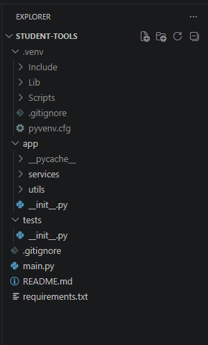
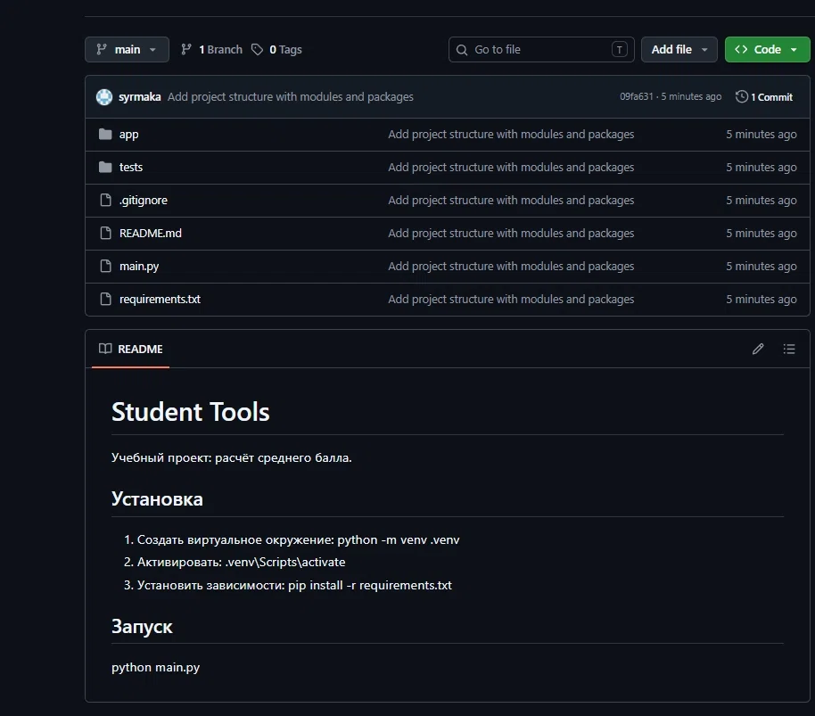

# Тема №2 — Структура Python-проекта

## 🛠️ Создали виртуальное окружение

- Создали папку `.venv` командой `python -m venv .venv`
- Активировали её (`.venv\Scripts\activate`)
- Это изолировало библиотеки проекта от системных

## 📦 Разложили код по модулям и пакетам

Создали структуру папок:

- `app/` — основной пакет приложения
- `app/services/` — бизнес-логика (`average_service.py`)
- `app/utils/` — вспомогательные функции (`formatter.py`)
- `tests/` — для будущих тестов

В каждую папку добавили `__init__.py`, чтобы пометить её как пакет.

Перенесли код из `main.py` в модули, а в `main.py` оставили только импорты и запуск.

### Структура проекта

## 📄 Зафиксировали зависимости

Выполнили `pip freeze > requirements.txt`.

Теперь любой может установить те же библиотеки одной командой.

## 📝 Оформили документацию

Написали `README.md` с описанием проекта, инструкцией по установке и запуску.

## 🚫 Настроили `.gitignore`

Добавили `.venv/`, `__pycache__/`, `*.pyc`.

Чтобы тяжёлые и временные файлы не попадали в Git.

## 🔧 Инициализировали Git

- `git init` — создали локальный репозиторий
- `git add .` — добавили все файлы
- `git commit -m "..."` — зафиксировали изменения

## 🚀 Отправили на GitHub

- Создали пустой репозиторий `student-tools` на GitHub
- Связали локальный проект с удалённым (`git remote add origin ...`)
- Переименовали ветку в `main`
- Отправили код командой `git push -u origin main`

### Репозиторий на GitHub

## ✅ Проверили результат

- Запустили `python main.py` — программа вывела `Средний результат: 4.40`
- Убедились, что файлы появились на GitHub
- Проверили, что `.venv` не попала в репозиторий

## 💎 Итог

У нас получился работающий, структурированный проект, который:

- имеет правильную структуру,
- разложен по модулям,
- воспроизводим (можно клонировать и запустить),
- готов к дальнейшей работе в следующих темах.